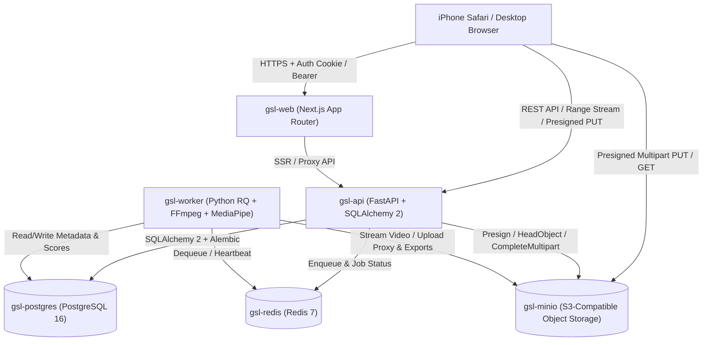

# ARCHITECTURE.md — 系統技術架構與 ADR

## 1. 系統拓樸與服務邊界

## 2. 核心架構決策紀錄（ADR）

### ADR-001：Monorepo 結構與共享分析核心
- **背景**：API 服務與背景 Worker 都需要存取儲存層（`packages/storage`）、分析與評分邏輯（`packages/analysis`）及資料模型。
- **決策**：採用 Python Workspace（由根目錄 `pyproject.toml` + `uv` 管理 `apps/api`, `apps/worker`, `packages/analysis`, `packages/storage`）搭配前端 `apps/web`（Next.js + TypeScript + Tailwind）與 `packages/contracts`。
- **優點**：重算分數（Recalculate Score）、單球手動調整後即時更新指標與背景批次分析共用同一套確定性（deterministic）Python 套件，消除邏輯分歧。

### ADR-002：大檔直傳與本地/雲端雙相容儲存策略
- **背景**：10–30 分鐘 iPhone 影片可達數百 MB 至數 GB，若全數經由 Web Server 記憶體緩衝會導致 OOM，但瀏覽器直傳 S3/MinIO 常受跨域（CORS）或內網端點限制。
- **決策**：
  1. `packages/storage` 實作完整 S3 Multipart Upload 生命週期（`create_multipart_upload`, `generate_presigned_url(upload_part)`, `complete_multipart_upload`, `abort_multipart_upload`）。
  2. 區分 `S3_INTERNAL_ENDPOINT_URL`（供 API/Worker 容器內部高速通訊）與 `S3_ENDPOINT_URL`（供瀏覽器簽名直傳）。
  3. 同時提供受認證與支援冪等 ETag 記錄的 API Part Upload Proxy endpoint（`/api/uploads/{id}/parts/{part_number}/content`）與 Range 串流端點，確保在任何網路拓樸（包含無公開 S3 網域的環境或嚴格 Safari CORS 環境）下都能 100% 完成分段續傳與 HTTP Range 播放。

### ADR-003：真實時間戳（PTS）與 VFR / 旋轉正規化
- **背景**：iPhone 錄製的 `.MOV`（HEVC）經常為可變影格率（VFR）且帶有 `rotation`（90° / 270°）display matrix。若僅用 `frame_idx / nominal_fps` 會導致長影片後半段時間碼嚴重漂移。
- **決策**：
  1. Ingest 階段使用 `ffprobe` 解析真實 stream metadata、duration、rotation、fps 分數（`r_frame_rate` / `avg_frame_rate`）與 frame PTS。
  2. 產生 H.264 + AAC、烘焙正確旋轉方向、關鍵影格對齊的瀏覽器預覽 Proxy 檔（供 Safari 順暢播放與精準 seek），同時保留原始檔供高畫質匯出。
  3. 揮桿切球與階段事件一律儲存相對於原片的毫秒時間碼（`start_ms`, `end_ms`, `time_ms`），透過 OpenCV `CAP_PROP_POS_MSEC` 與 FFmpeg PTS 雙向驗證。

### ADR-004：Coarse-to-Fine 揮桿偵測與 9 階段狀態機
- **背景**：對 30 分鐘 60fps 影片逐幀跑重度推論會耗盡 CPU/RAM。
- **決策**：
  1. **Coarse Scan**：以串流方式每 200ms–333ms（3–5 fps）取樣低解析度影格，計算人體存在度與手腕/上肢相對運動能量曲線，聚類出活動視窗（Activity Windows）。
  2. **Fine Scan**：僅對候選視窗 ±緩衝區以 15–30 fps 解碼並執行 MediaPipe Pose Landmarker（若環境無 GPU 則使用 CPU Lite/Full 模型；若偵測到多重遮擋則降級至運動特徵並標記 `low_confidence`），驅動 9 階段有限狀態機：
     `IDLE → ADDRESS_CANDIDATE → TAKEAWAY → BACKSWING → TOP → DOWNSWING → IMPACT_ESTIMATED → FOLLOW_THROUGH → FINISH → IDLE`
  3. **去重與分類**：使用 Time-Range IoU 合併重疊區段，並依準備姿勢、下桿峰值速度與隨揮完整性區分 `valid_swing`、`practice_swing`（空揮）與 `swing_candidate`。
