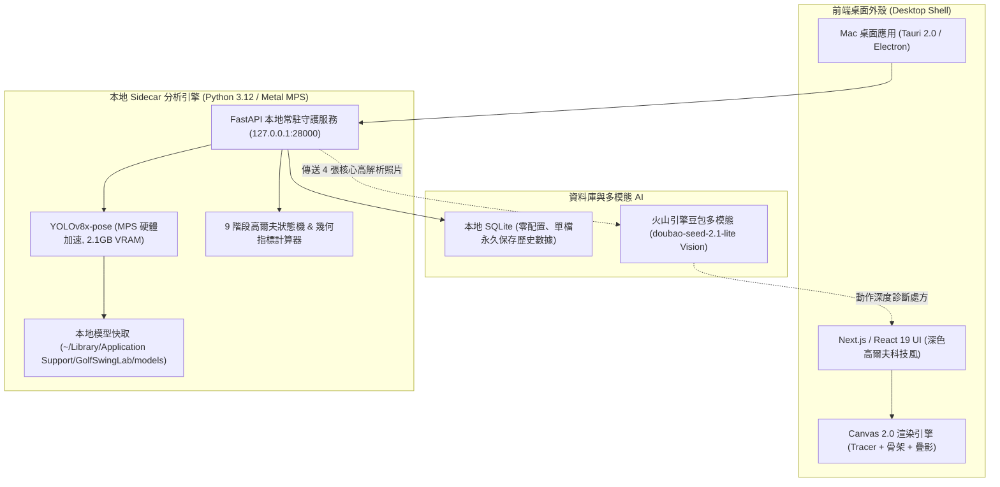

# Golf Swing Lab — Mac 桌面獨立應用與模擬器級體驗迭代規劃書

> **目標定位**：將 Golf Swing Lab 打造成一款無需依賴外部雲端伺服器、開箱即用、完全在 Mac 本機（利用 Apple Silicon M 系列晶片強大 Unified Memory 與 Metal 算力）運行的 **高爾夫專業分析桌面應用程式**。
> 具備媲美商業室內模擬器（TrackMan / GCQuad）的 **出球路徑動態視覺化**、**PGA 職業標竿動作疊影對比**、**豆包多模態 AI 視覺教練診斷**，以及 **長期訓練進步成長曲線**。

---

## 一、 總體系統架構（Mac 桌面端）

---

## 二、 4 大室內模擬器級核心能力規劃

### 1. 出球路徑線動態視覺化 (Ball Launch Tracer 3D 透視版)
- **原理與定位**：
  在下桿最後 2 幀與擊球瞬間（Impact），以手腕與桿面通過角為基準，自動推算球員的出球方向向量（Launch Azimuth）與起飛仰角（Launch Angle）。
- **視覺呈現**：
  - 擊球前：地面球位鎖定與備戰光標。
  - 擊球後：沿著揮桿釋放平面向遠方球道投射高爾夫專業 Toptracer 螢光追蹤動態弧線（支持 0.25x 慢動作步進）。
  - 標示推估初速等級、推定出球仰角與彈道頂點（Apex）。

### 2. PGA 職業標竿姿勢 vs 我的姿勢修正 (Pro Ghost Overlay 幽靈疊影)
- **原理與定位**：
  球友最常問「我到底差在哪裡？」。系統內建標準 PGA Tour 巡迴賽職業選手的黃金幾何骨架（含 DTL 視角 7 鐵與開球木桿標準範本）：
- **視覺呈現**：
  - **幽靈半透明疊影（Ghost Overlay）**：將職業選手的標準骨架（半透明金黃色）精準等比例貼合在球友的畫面上。
  - **即時視覺修正標註**：
    - **準備姿勢 (Address)**：紅線標示「脊椎前傾過度彎曲 Δ=8°」或「站姿離球過遠」。
    - **上桿頂點 (Top)**：虛線標註「手腕過度外翻 (Cupping)」或「上桿未充分旋轉 (Over-swinging)」。
    - **擊球瞬間 (Impact)**：標註「提早起身開胯 (Early Extension)」或「重心滯後」。
    - **收桿平衡 (Finish)**：標註「骨盆是否完全面朝目標、左腳抓地是否穩固」。

### 3. 豆包多模態 AI 視訊視覺教練 (Vision-Ground Multi-modal Coach)
- **架構升級**：
  目前的 AI 教練僅接收純文字數值，升級為**真正具備「視覺大腦」的 AI 教練**：
- **運作機制**：
  - 本地 YOLO 切出揮桿後，自動擷取 **4 張高解析原片定格截圖**（Address、Top、Impact、Finish）。
  - 將這 4 張圖片與幾何指標打包送入火山引擎 `doubao-seed-2.1-lite` Vision API。
  - **輸出深度教練報告**：
    1. **本球核心痛點診斷**（例如：「您在頂點時手肘向外飛（Flying Elbow），導致下桿容易外拉內下切球造成右曲球」）。
    2. **對比職業選手的具體落差**。
    3. **今日專屬改善課表 (3 項針對性 Drills)**。

### 4. 個人長期訓練進步成長曲線 (Progress Analytics & Trends)
- **數據指標庫**：
  - **綜合動作評分趨勢折線圖**（按日期、按球桿 7I / Driver 篩選）。
  - **軀幹前傾穩定度趨勢**（記錄起身起伏幅度是否逐場縮小）。
  - **上下桿節奏一致性曲線**（監控節奏比是否穩定維持在 3.0:1 的職業黃金區間）。
  - **手部重複性與離散度雷達圖**（衡量出桿軌跡的一致性）。
  - **個人最佳揮桿成就庫（Personal Bests）**：自動將生涯 Top 10 最優揮桿保存為標竿對照球。

---

## 三、 四階段迭代實施計劃 (Phase 1 – Phase 4)

| 階段 | 主題名稱 | 核心交付目標 | 預計工作重點 | 驗收標準 (DoD) |
|---|---|---|---|---|
| **Phase 1** | **YOLOv8x 本地引擎與 Mac 硬體加速** | 替換 MediaPipe，實現 Mac 本機 2.1GB 頂級權重常駐推論 | 1. 整合 `ultralytics` 與 `mps` 加速。 2. 實作 `YoloPoseExtractor` 適配器。 3. 模型自動下載並快取至本機目錄。 4. 狀態機適應 17 點高精度座標。 | 使用真實 2 分鐘影片測試，下桿手腕 100% 咬住無殘影丟失，12 記擊球 100% 成功提取關鍵點。 |
| **Phase 2** | **豆包多模態真·視覺傳輸 & 出球 Tracer 強化** | 讓 AI 教練親眼「看見」動作照片，強化出球拋物線動態 | 1. 抽取 4 張高解析定格轉 Base64。 2. 串接豆包多模態 Vision API。 3. 實作 3D 透視出球軌跡（Ball Tracer）。 4. 慢動作播放時出球軌跡與飛行白球動態同步。 | AI 教練報告具體指出照片中的手腕與站姿細節；前端 Canvas 出球動態流暢呈現。 |
| **Phase 3** | **PGA 職業標竿幽靈疊影 & 個人進步成長曲線** | 提供直觀的「我跟職業選手差在哪」與歷史趨勢圖表 | 1. 建立 PGA 標準動作幾何模型。 2. 實作前端 Ghost Overlay 疊影開關。 3. 在資料庫建立球桿分類與歷史統計表。 4. 前端總覽頁增加 Recharts 趨勢折線圖。 | 使用者能切換顯示職業選手疊影，紅綠標註骨架差異；首頁清晰呈現歷史動作評分成長曲線。 |
| **Phase 4** | **Mac 原生獨立安裝包 (Tauri / Electron 打包)** | 封裝成一鍵安裝之 `.dmg` 桌面應用程式 | 1. 打包 Python Sidecar (含 PyInstaller / uv 虛擬環境)。 2. 前端與本地守護進程自動拉起與健康檢查。 3. 構建 Mac `.dmg` 安裝檔。 4. 首次開機引導（包含 API Key 與模型快取檢查）。 | 在乾淨 Mac 系統上雙擊安裝即可直接執行，無需手動開啟終端機或打命令。 |

---

## 四、 關鍵技術相依與選型建議

1. **桌面外殼**：
   - 推薦 **Tauri 2.0 (macOS)**：基於 Rust，封裝體積極小（約 15MB），直接調用系統原生 WebKit，記憶體佔用遠低於 Electron。
   - 替代方案 **Electron**：相容性極高，與 Next.js 整合成熟。
2. **本機 AI 運算架構**：
   - `torch` + `ultralytics`，設定 `device="mps"`（調用 Apple Silicon Neural Engine 與 GPU）。
   - 模型檔案持久化儲存於 `~/Library/Application Support/GolfSwingLab/models/yolov8x-pose.pt`。
3. **雲端多模態 AI**：
   - 火山引擎 `doubao-seed-2.1-lite`（具備極佳的多模態性價比，支援一次傳送 4 張高解析截圖）。
4. **資料庫引擎**：
   - 本地 `SQLite`（透過 SQLAlchemy 2 驅動，零需安裝外部服務，單一檔案永久儲存歷史記錄）。
